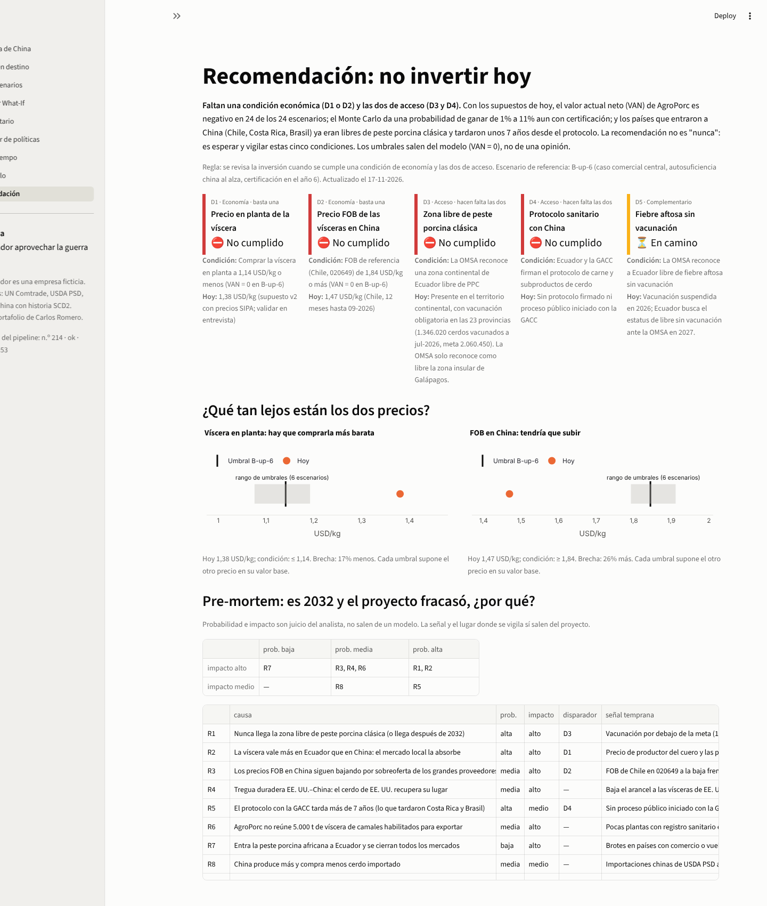
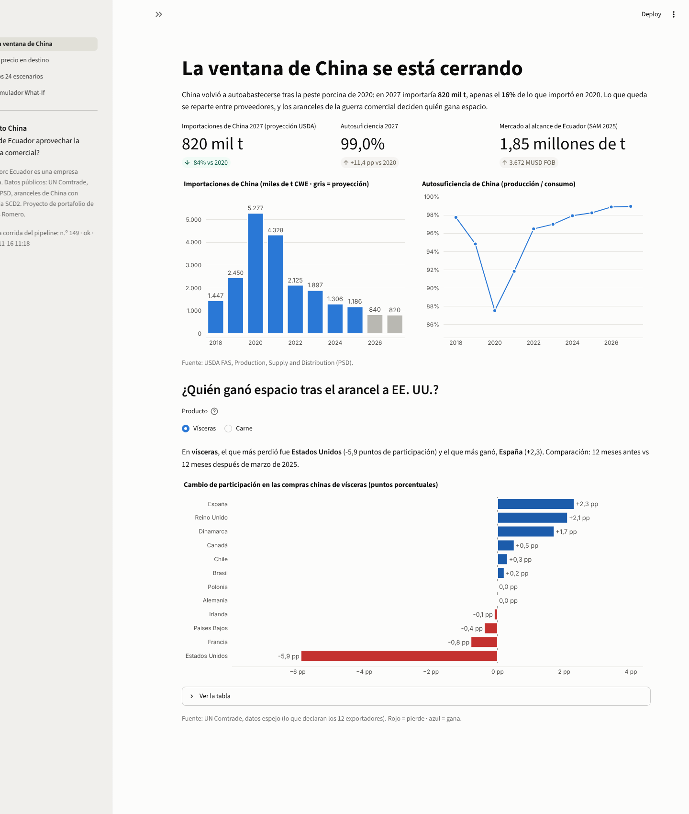
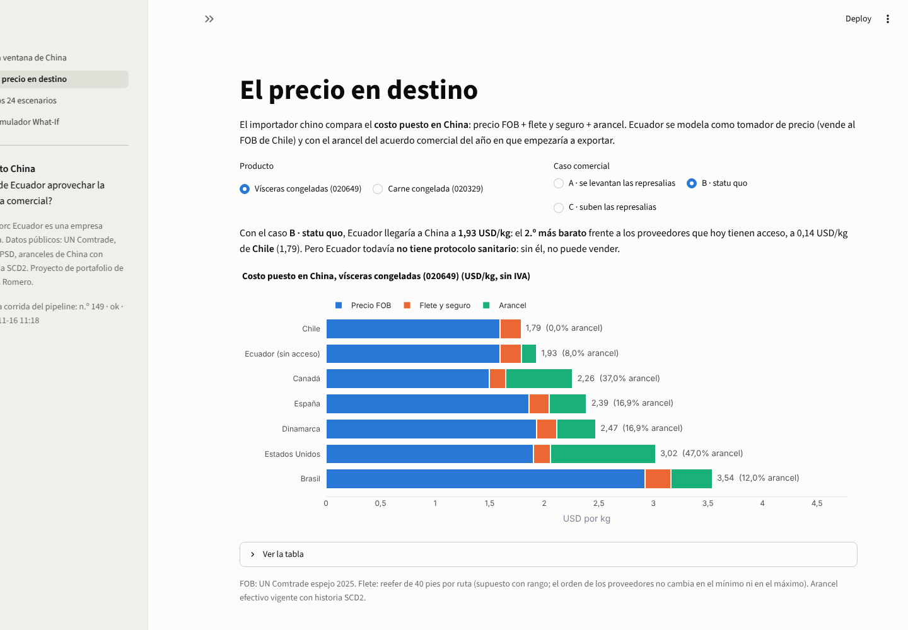
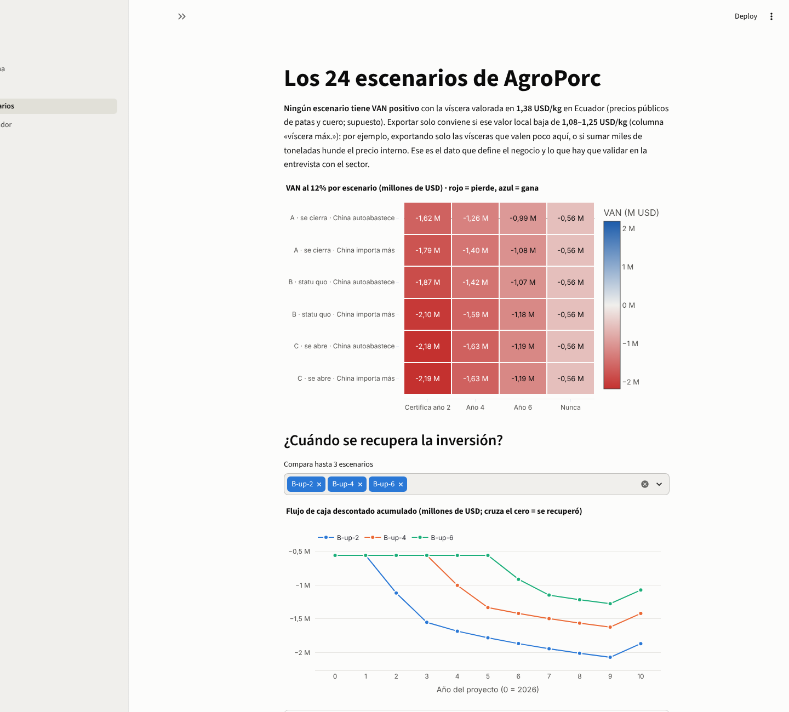
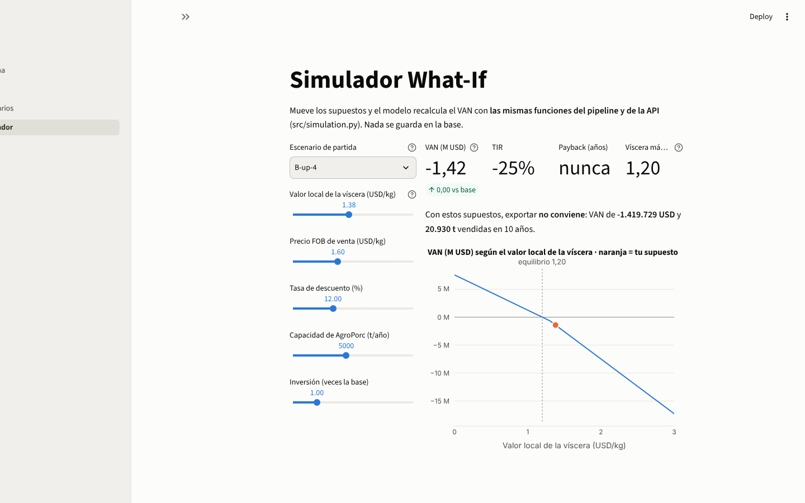
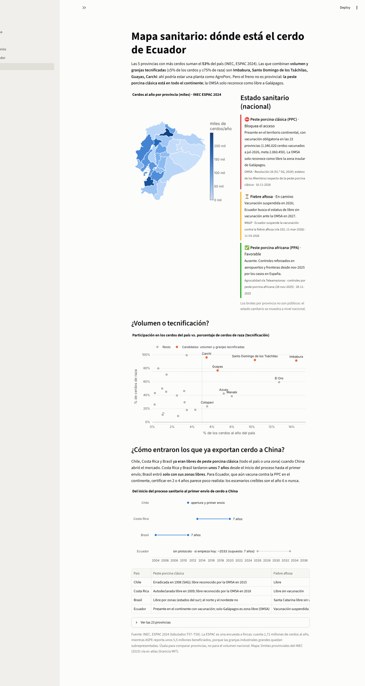
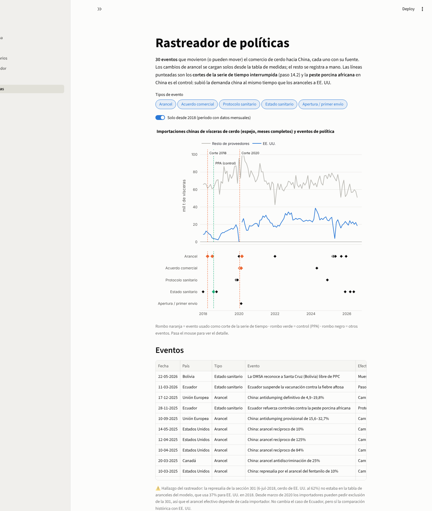
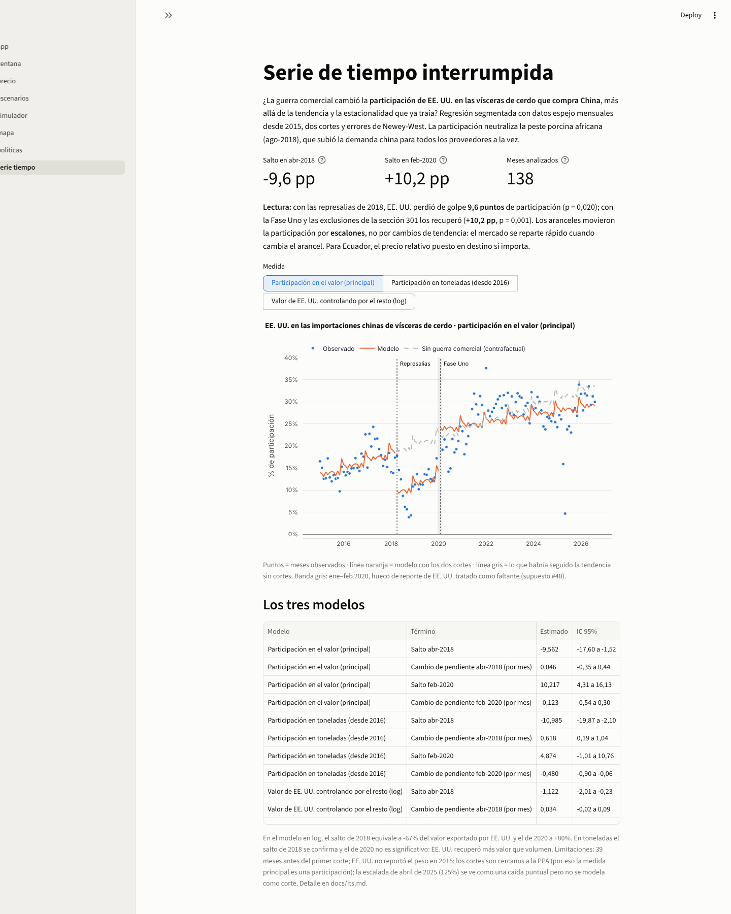
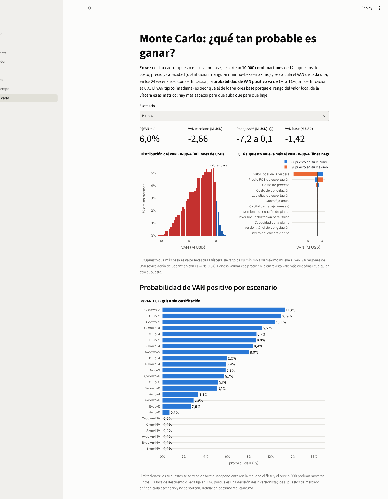
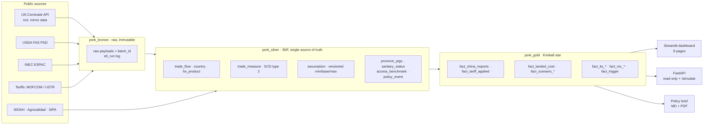

# Pork to China · Can Ecuador benefit from the US–China trade war?

**Short answer: not today — and the project says exactly what would have to change.**

A market-entry study for a fictional Ecuadorian pork processor (*AgroPorc Ecuador*), built end to end with public data: a MySQL medallion warehouse, a 15-stage tested pipeline, a financial model with 24 scenarios, causal and probabilistic analysis, a 9-page dashboard, a REST API and a two-page policy brief.

    

> **Resumen en español.** Estudio de entrada del cerdo ecuatoriano a China para una empresa ficticia (AgroPorc Ecuador), hecho solo con datos públicos (UN Comtrade, USDA, INEC, OMSA, Agrocalidad). La guerra comercial sí abrió un espacio en las vísceras que compra China, pero hoy no conviene invertir: Ecuador no tiene permiso sanitario (no es libre de peste porcina clásica en el continente) y cada kilo exportado dejaría un margen negativo. El proyecto define cinco disparadores medibles para revisar la decisión, un pre-mortem y un policy brief para Agrocalidad y el Ministerio de Producción. Documentación detallada en español en [`docs/`](docs/).

---

## Key findings

| # | Finding | Evidence |
|---|---|---|
| 1 | **The window is real but reversible.** After China's 2025 tariffs, the US share of China's pork-offal imports fell from 28.7% to 22.8% of tonnes; in 2018 it lost 9.6 points and won back 10.2 in 2020 once exclusions arrived. | Interrupted time series with Newey-West errors, 2015–2026 ([`docs/its.md`](docs/its.md)) |
| 2 | **Ecuador has no sanitary access.** The WOAH recognizes only the Galápagos as free of classical swine fever; Chile, Costa Rica and Brazil were free (or had free zones) and took ~7 years from protocol to first shipment. | Access benchmark ([`docs/assumptions.md`](docs/assumptions.md) #44–#46) |
| 3 | **Volume doesn't save it — the margin is negative.** China pays 1.47 USD/kg (Chile's FOB, last 12 months); the offal is worth 1.38 in Ecuador and processing + freezing + logistics cost 0.25 → **−0.16 USD per kg**. NPV is negative in **24 of 24** scenarios. | Financial model + 10,000-draw Monte Carlo: P(NPV > 0) = **1%–11%** with certification ([`docs/monte_carlo.md`](docs/monte_carlo.md)) |
| 4 | **What would change the decision:** buying offal at ≤ 1.14 USD/kg *or* an FOB ≥ 1.84, **and** a continental CSF-free zone **and** a signed protocol with China's GACC. Thresholds come from the model (NPV = 0), not opinion. | Triggers recomputed on every run ([`docs/triggers.md`](docs/triggers.md)) |

**Deliverables for decision-makers:** [one-page recommendation](docs/recommendation.md) · [pre-mortem](docs/premortem.md) · [policy brief (PDF, 2 pages)](docs/policy_brief.pdf)



<details>
<summary><b>The other 8 dashboard pages</b></summary>

| | |
|---|---|
|  China's window |  Landed price in China |
|  24 scenarios |  What-if simulator |
|  Sanitary map by province |  Policy tracker |
|  Interrupted time series |  Monte Carlo |

</details>

---

## Architecture



- **Medallion on MySQL 8** ([ADR-001](docs/adr/ADR-001-medallion-mysql.md)): raw data is never overwritten, every transformation can be replayed, and the design maps 1:1 to a Fabric/Databricks lakehouse.
- **Least privilege:** the dashboard and API connect as `pork_bi`, which can read **gold only**; silver data reaches them through `SQL SECURITY DEFINER` views. The ETL user is the only one that writes.
- **Versioned migrations** (`sql/migrations/001–022`) applied by `src/migrate.py` and recorded with a SHA-256 checksum; an applied migration is never edited.
- **Tariff history as SCD type 2** ([ADR-002](docs/adr/ADR-002-scd2-trade-measures.md)): the effective tariff for any origin × HS code × month is reproducible, including Section 232/301 retaliation and the 2025 escalation.
- **Mirror data** ([ADR-008](docs/adr/ADR-008-datos-espejo.md)): China reports to Comtrade with a lag, so its imports are rebuilt from what its 12 suppliers declare.

### The pipeline

`.\pipeline.ps1` runs 15 stages, each as an isolated subprocess, stopping at the first failure; every run is logged in `pork_bronze.etl_run`, a MySQL lock prevents concurrent runs, and it is idempotent.

```
migrate → silver_comtrade → silver_psd → silver_espac → validate (12 data-quality rules) → gold
→ queries (12 business SQL queries) → landed_cost → scenarios → finance → its → monte_carlo
→ recommendation → policy_brief → tests (210)
```

## Methods

| Method | What it answers | Where |
|---|---|---|
| Window functions, CTEs, Pareto, percent rank | Who supplies China, at what price, who gained share | [`sql/queries/`](sql/queries/) → [`docs/queries.md`](docs/queries.md) |
| Landed-cost model | Price in China per supplier after freight and tariff | [`src/landed_cost.py`](src/landed_cost.py) |
| 24 scenarios (3 trade cases × 2 Chinese self-sufficiency paths × 4 certification years) | Market ceiling for Ecuador year by year | [`src/scenarios.py`](src/scenarios.py) |
| Cash-flow model: NPV, IRR, payback, break-even | Is AgroPorc's investment worth it? | [`src/finance.py`](src/finance.py), [ADR-010](docs/adr/ADR-010-modelo-financiero.md) |
| Interrupted time series, segmented regression with Newey-West SEs (NumPy) | Did the trade war really move US share, and does it reverse? | [`src/its.py`](src/its.py), [ADR-011](docs/adr/ADR-011-serie-tiempo-interrumpida.md) |
| Monte Carlo, 10,000 triangular draws, common random numbers, tornado + Spearman | How likely is a positive NPV, and which assumption matters? | [`src/monte_carlo.py`](src/monte_carlo.py) |
| Decision triggers + pre-mortem | When to revisit the decision; how it could fail | [`src/recommendation.py`](src/recommendation.py) |

Every assumption has a min/base/max range and a source, or is explicitly marked as an assumption: [`docs/assumptions.md`](docs/assumptions.md) (53 entries).

## Run it

Requirements: Windows, Python 3.12+, MySQL 8, a free [UN Comtrade API key](https://comtradedeveloper.un.org/).

```powershell
.\setup.ps1        # virtual env, pinned dependencies, .env from the template
.\db_setup.ps1     # creates the 3 schemas and the pork_etl / pork_bi users
.\extract.ps1      # UN Comtrade → bronze (incremental, cached); .\psd.ps1 for USDA
.\pipeline.ps1     # the 15 stages above
.\dashboard.ps1    # Streamlit dashboard
.\api.ps1          # FastAPI docs at http://127.0.0.1:8000/docs
.\snapshot.ps1     # public Parquet copy of gold for the online dashboard
```

**Online dashboard.** The published app (Streamlit Community Cloud) has no MySQL: it reads `data/snapshot/`, a Parquet copy of the 23 gold tables and views the dashboard uses, with DuckDB running the **same SQL** ([`src/gold_source.py`](src/gold_source.py)). The copy is refreshed by re-running `.\snapshot.ps1` after the pipeline and pushing it; `tests/test_snapshot.py` checks every query and page against it. Setup steps: [`docs/tablero_en_linea.md`](docs/tablero_en_linea.md).

## Repository layout

```
src/            pipeline modules (extract, harmonize, validate, gold, models, analysis)
src/dashboard/  Streamlit app (9 pages) · src/api/  FastAPI
sql/            migrations/ (001–022) and queries/ (q01–q12)
tests/          210 pytest tests (unit + integration against the real warehouse)
docs/           architecture, KPIs, ER diagram, assumptions, ADRs, generated reports
```

## Limitations

- AgroPorc is **fictional**; costs and capacity are public-data estimates marked as assumptions.
- The plant price of offal (the assumption that moves the result most) has no public series; it is estimated from SIPA producer prices and must be validated with industry interviews ([`docs/interview_guide.md`](docs/interview_guide.md)).
- Assumptions are drawn independently in the Monte Carlo; some move together in reality.
- China's FTAs with Peru, Australia, New Zealand and Switzerland are not modelled (those suppliers pay MFN in gold), and Ecuador's tariff phase-out under its FTA with China is assumed linear.

---

*Portfolio project by **Carlos Romero** (Guayaquil, Ecuador). Public data only; not investment advice. Detailed documentation is in Spanish.*
