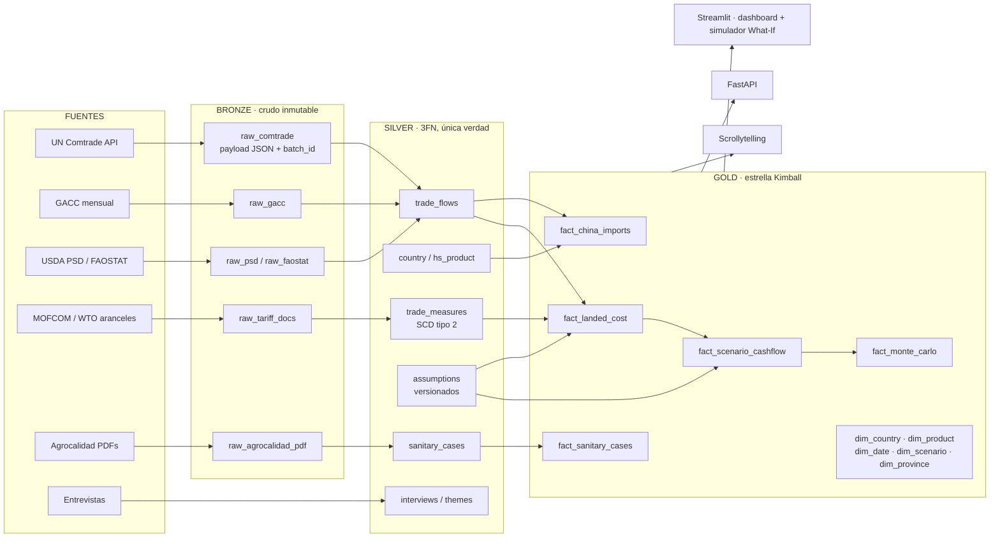

# Arquitectura de datos

## Comparativa de alternativas

| Alternativa | Qué es | Ventaja | Por qué no (o qué tomamos) |
|---|---|---|---|
| Base única sin capas | Se limpia la tabla al cargarla y se sobrescribe | Simple | Se pierde el crudo; no se puede reconstruir el análisis en una fecha pasada |
| Inmon | Data warehouse corporativo en 3FN + data marts | Una sola verdad | Lento de consultar para BI → **lo tomamos para silver** |
| Kimball | Esquema estrella | Rápido para BI | Sin capa limpia, la lógica se repite → **lo tomamos para gold** |
| **Medallion (elegida)** | bronze → silver (3FN) → gold (estrella) | Trazable y reprocesable | Más tablas; se acepta por la auditoría |
| Lakehouse (Fabric / Databricks) | Medallion sobre Delta/Parquet con Spark | Escala a terabytes | Excesivo para el volumen; el diseño migra 1:1 |
| Lambda / Kappa | Batch + streaming / solo streaming | Tiempo real | Los datos son mensuales; no aporta |
| ETL vs ELT | Transformar antes o después de cargar | ELT conserva el crudo | Híbrido: EL a bronze + T en Python hacia silver/gold |

### Migración a Microsoft Fabric
bronze → Lakehouse *Files*; silver/gold → tablas Delta; `src/*.py` → notebooks PySpark; `pipeline.py` → Data Factory; el tablero de Streamlit → informe de Power BI en Direct Lake, si algún día se necesita.

## Diagrama de punta a punta

## Recorrido de un dato: vísceras de EE. UU. → China, marzo de 2025
1. **Bronze:** Comtrade (reporter 156, partner 842, HS 020649, periodo 202503) → `bronze.raw_comtrade` (JSON intacto + source_name, extracted_at, batch_id). Una corrección posterior entra como fila nueva.
2. **Silver:** `silver.trade_flows` (CHN, USA, 020649, 2025-03-01, net_weight_kg, value_usd, source, gacc_match_flag); `hs_product` → product_group='offal'; `trade_measures` con SCD2 (valid_from / valid_to).
3. **Gold:** `fact_china_imports` (date_key=20250301, partner_key, product_key, tonnes, value_usd, unit_value_usd_kg, share_pct); `landed_cost.py` cruza la tasa con `period BETWEEN valid_from AND valid_to`.
4. **Consumo:** app de Streamlit (página "La guerra comercial en datos") y `/trade-diversion` en la API.

## Guion de entrevista
"Usé una arquitectura Medallion en MySQL: bronze guarda las respuestas crudas de las APIs con auditoría, silver es un modelo en 3FN que funciona como única versión de la verdad, y gold es un esquema estrella que consumen la app de Streamlit y la API. Los aranceles se guardan con SCD tipo 2, así cada mes histórico se cruza con la tasa que estaba vigente en ese momento. El diseño migra casi 1:1 a un Lakehouse en Fabric."
