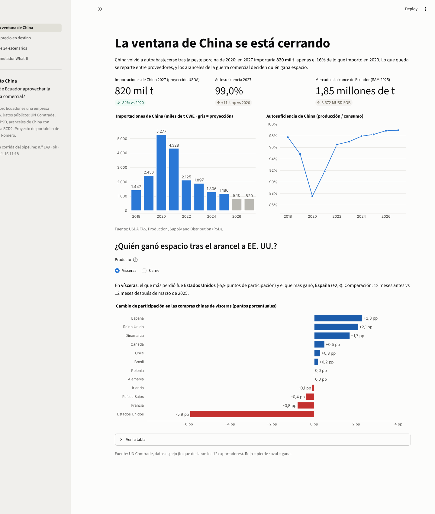
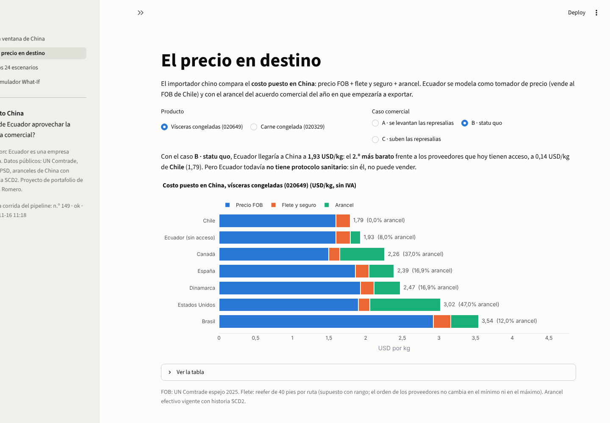
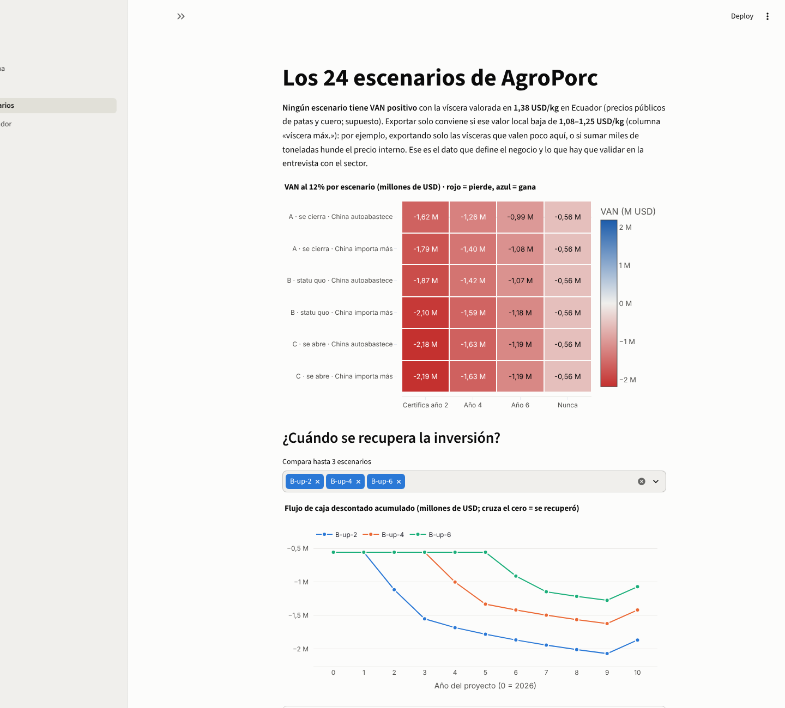
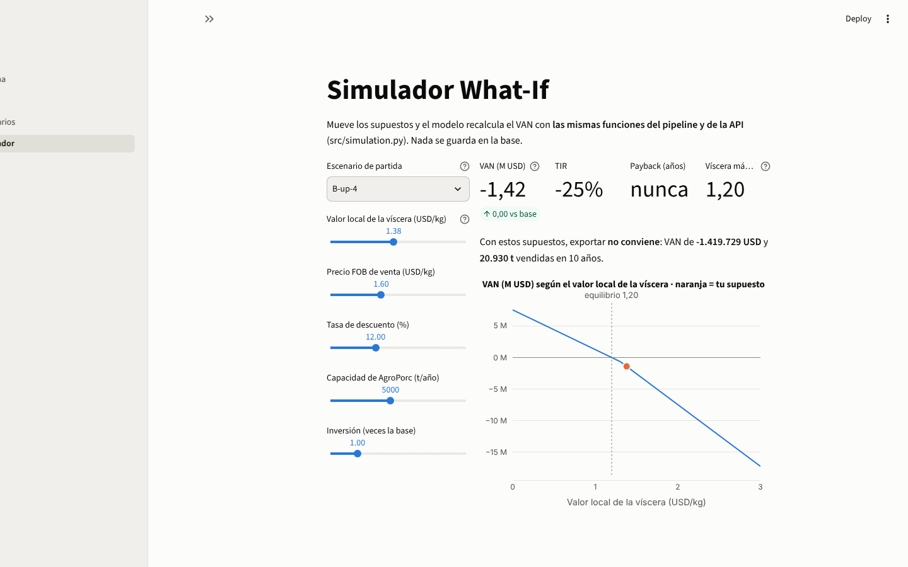
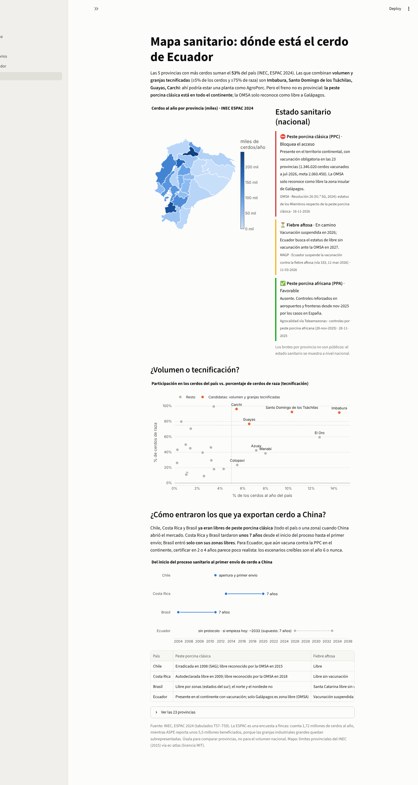
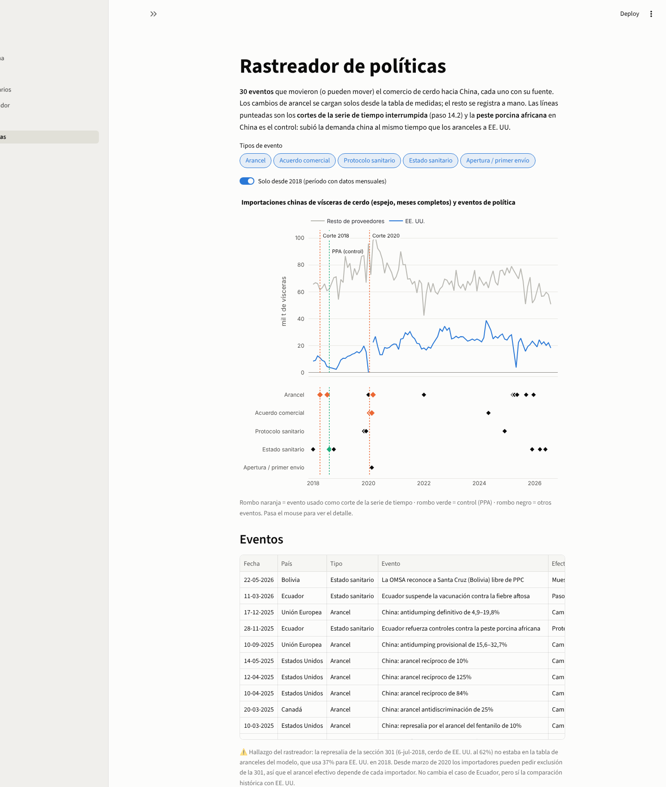
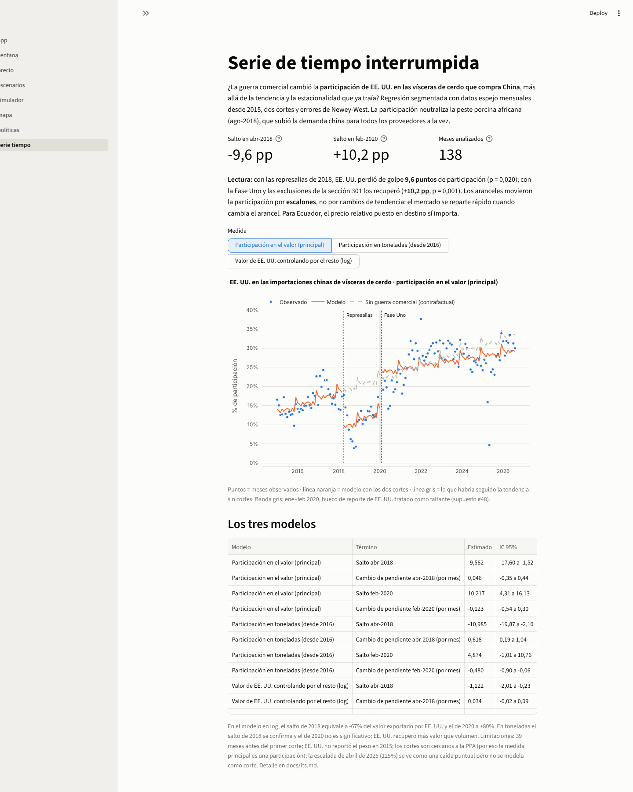
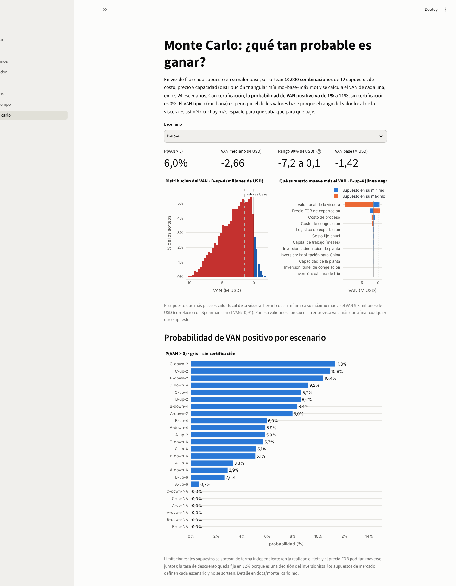
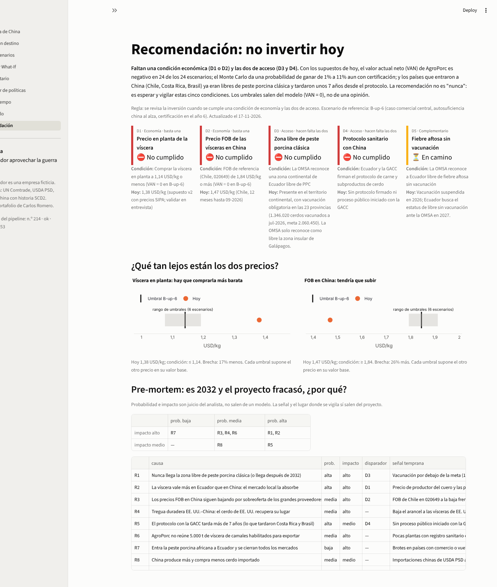

# Tablero de Pork to China (Streamlit)

Levantarlo: `.\dashboard.ps1` → <http://localhost:8501>. Lee `pork_gold` con el usuario de solo lectura (`pork_bi`);
el simulador usa `src/simulation.py`, la misma función que la API (`POST /simulate`) y que el pipeline.

| Página | Pregunta que responde |
|---|---|
| 1 · La ventana de China | ¿Cuánto importa China y quién ganó espacio tras los aranceles? |
| 2 · El precio en destino | ¿Cuánto le cuesta a un importador chino 1 kg según su origen? |
| 3 · Los 24 escenarios | ¿En qué escenarios conviene invertir y cuánto cuesta demorar la certificación? |
| 4 · Simulador What-If | ¿Qué pasa con el VAN si cambian la víscera, el precio, la tasa, la capacidad o la inversión? |
| 5 · Mapa sanitario | ¿Dónde está el cerdo de Ecuador, qué provincias tienen granjas tecnificadas, qué frena el acceso a China y cuánto tardaron Chile, Costa Rica y Brasil? |
| 6 · Rastreador de políticas | ¿Qué aranceles, acuerdos, protocolos y cambios sanitarios hubo, y qué pasó con las importaciones de vísceras alrededor de cada uno? |
| 7 · Serie de tiempo | ¿La guerra comercial cambió la participación de EE. UU. en las vísceras que compra China, más allá de la tendencia y la estacionalidad? |
| 8 · Monte Carlo | ¿Qué probabilidad hay de que el VAN sea positivo y qué supuesto pesa más? |
| 9 · Recomendación | ¿Invertimos hoy? ¿Qué tendría que cambiar (disparadores en semáforo) y cómo podría fracasar (pre-mortem)? |

## Decisiones de diseño
- **Cada página abre con su conclusión escrita**; los gráficos la respaldan. Los textos se calculan con los datos
  (si los datos cambian, la frase cambia).
- **Paleta validada para daltonismo** (skill dataviz, `validate_palette.js`): azul, naranja y aqua en orden fijo;
  rojo ↔ azul con punto medio gris para valores con signo (VAN, cambio de participación); gris para el contexto y
  las proyecciones. El aqua tiene poco contraste con el fondo → siempre con etiquetas y tabla.
- **Un solo eje por gráfico**, números en formato español, tabla disponible en cada gráfico ("Ver la tabla").
- **Caché de 10 minutos** en las consultas (`st.cache_data`): el tablero no vuelve a la base en cada clic.
- Si no hay base de datos, la barra lateral lo dice en lugar de que la aplicación se caiga.
