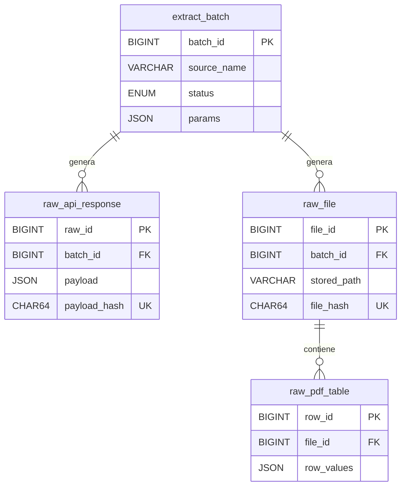
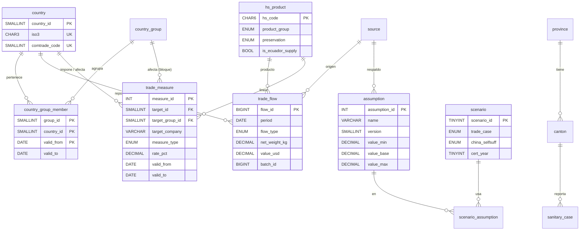
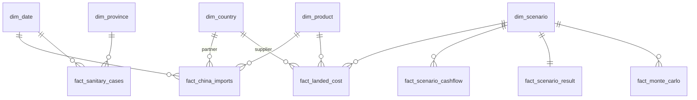

# Modelo de datos (ER)

Tres bases MySQL: `pork_bronze` (crudo), `pork_silver` (3FN) y `pork_gold` (estrella). Scripts en `sql/`.

## Bronze · crudo inmutable

## Silver · 3FN

## Gold · estrella

## Decisiones de diseño
1. **Pertenencia a la UE con vigencia** (`country_group_member`): el Reino Unido salió el 31-01-2020.
2. **`trade_measure` en SCD tipo 2** (ADR-002): destino = país, bloque o todos (NMF); tasa por empresa para el antidumping. La columna generada `target_key` permite una clave única aunque haya NULL. "Vigente" se calcula con la fecha (vista `v_trade_measure_current`), porque el antidumping a la UE tiene fin programado en 2030.
3. **Supuestos versionados + escenarios con tabla puente**: los escenarios viejos siguen siendo reproducibles.
4. **Silver guarda unidades crudas** (kg, USD); gold, las métricas derivadas.
5. **`comtrade_code` separado del ISO**: Comtrade usa códigos propios (Francia = 251).
6. **CHECKs**: periodo = día 1, tasas en 0–1000%, mín ≤ base ≤ máx, fechas coherentes.

## Seguridad
- `pork_etl`: lectura/escritura en las 3 bases (pipeline).
- `pork_bi`: solo `SELECT` en `pork_gold` (app de Streamlit y API).
- Root solo se usa una vez, en `db_setup.py`, y su contraseña no se guarda.
