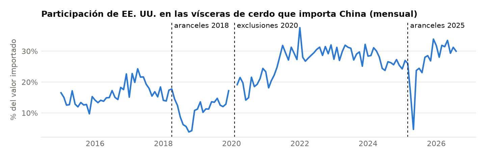
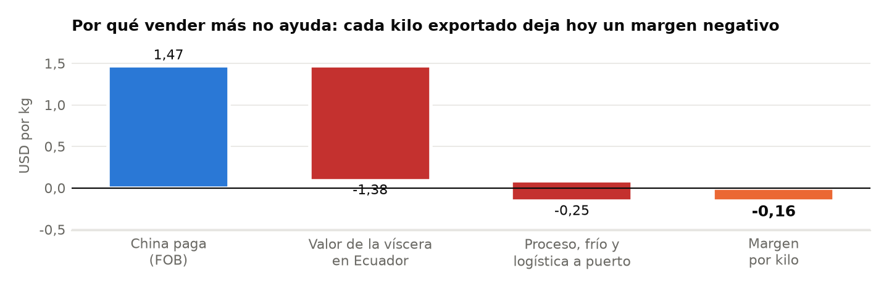

# Del arancel a la oportunidad: qué necesita Ecuador para vender vísceras de cerdo a China

*Policy brief · Para: Agrocalidad y Ministerio de Producción, Comercio Exterior, Inversiones y Pesca · 17-11-2026 · Carlos Romero, proyecto de portafolio Pork to China*

## El problema

La guerra comercial entre Estados Unidos y China abrió un espacio para otros proveedores de cerdo. Ecuador no puede ocuparlo: no tiene permiso sanitario para exportar cerdo a China y, aun si lo tuviera, a los precios de hoy cada kilo exportado dejaría pérdida. Este documento propone tres acciones públicas que no dependen de ninguna empresa y que convierten la próxima ventana en una oportunidad real.

## Lo que muestran los datos

- La ventana existe, pero se abre y se cierra. Tras los aranceles de 2025, Estados Unidos pasó de 28,7% a 22,8% de las vísceras que compra China (-5,9 puntos, en toneladas), pero en valor ya volvió a cerca del 30% en los últimos meses. En 2018 perdió 9,6 puntos y en 2020 recuperó 10,2 cuando llegaron las exclusiones (serie de tiempo interrumpida, 2015–2026).
- El acceso sanitario tarda. Costa Rica y Brasil necesitaron unos 7 años desde el inicio del protocolo hasta el primer envío, y entraron siendo libres de peste porcina clásica (Brasil, por zonas). En Ecuador la OMSA solo reconoce como libre la zona insular de Galápagos.
- El mercado no es el límite; el margen sí. China importó 1,04 millones de toneladas de vísceras congeladas (HS 020649) en 2025, por 1,92 mil millones de USD. Pero hoy China paga 1,47 USD/kg y la víscera vale 1,38 en Ecuador: con 0,25 de proceso y logística, el margen es -0,16 USD por kilo. Con margen negativo, más volumen significa más pérdida: el valor actual neto es negativo en 24 de 24 escenarios.

## Tres propuestas (recomendaciones del analista)

### 1. Una zona continental libre de peste porcina clásica, empezando por las provincias que más producen

Imbabura, Santo Domingo, Guayas y Carchi concentran el 37% de los cerdos que se venden al año (ESPAC 2024) y tienen al menos 75% de cerdos de raza. Una zona libre reconocida por la OMSA en esas provincias, como hizo Brasil con Santa Catarina, es la condición previa para cualquier protocolo con China.

> Quién lidera: Agrocalidad, con los productores (ASPE). Plazo sugerido: plan con metas por provincia en 2027 y expediente ante la OMSA cuando se cumplan los requisitos.

### 2. Abrir ya la conversación del protocolo sanitario con China, con las vísceras incluidas desde el inicio

Si el proceso toma unos 7 años, esperar a tener la zona libre para empezar suma los dos plazos. Conviene avanzar en paralelo y pedir desde el principio carne y subproductos: Costa Rica exportó vísceras desde su primer envío mientras que Chile amplió su protocolo a subproductos congelados recién en 2024, trece años después de abrir el mercado.

> Quién lidera: Ministerio de Producción (negociación comercial) con Agrocalidad (autoridad sanitaria ante la GACC). Plazo sugerido: carta de interés y cuestionario sanitario en 2027.

### 3. Publicar el precio en planta de las vísceras y subproductos de cerdo

La variable que decide si exportar conviene no tiene serie pública. Este análisis tuvo que estimarla con los precios de productor del cuero y las patitas del SIPA y un factor de descuento tomado del pollo. Una serie mensual por provincia permitiría a cualquier empresa hacer este cálculo con datos reales.

> Quién lidera: SIPA (Ministerio de Agricultura y Ganadería), con apoyo del Ministerio de Producción. Plazo sugerido: primera publicación en 2027.

## Qué cambiaría si se cumplen

El acceso es necesario pero no suficiente. Con protocolo y zona libre, una empresa como la del caso (5.000 t/año de capacidad) podría colocar entre 2.920 y 3.840 t/año en el escenario central, apenas el 0,37% de lo que importa China: Ecuador sería tomador de precio. Por eso la inversión solo conviene si además la víscera se consigue a 1,14 USD/kg o menos en planta, o si el precio en China sube a 1,84 o más. Las propuestas 1 y 2 abren la puerta; la 3 permite saber, con datos públicos, cuándo cruzarla.

## Fuentes y límites

UN Comtrade (datos espejo de las importaciones de China, 2015–2026); USDA FAS PSD; INEC, ESPAC 2024; OMSA, Resolución 26 (2024) sobre peste porcina clásica; Agrocalidad (campaña de vacunación 2026); SIPA/MAG; benchmark de acceso de Chile, Costa Rica y Brasil (prensa sectorial). Modelo financiero y Monte Carlo del proyecto: github.com/CarlosRomero55/pork-to-china. AgroPorc Ecuador es una empresa ficticia; las propuestas son recomendaciones del autor y no representan la posición de ninguna institución. No es asesoría de inversión.

